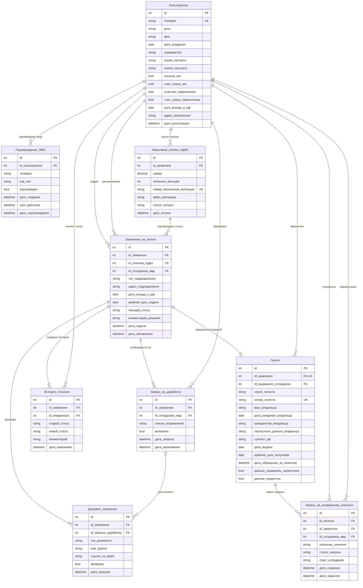

# Лабораторная работа №2. ER-диаграмма предметной области

**Тема №6:** Подача заявления и получение патента.

## Диаграмма сущностей предметной области

Пояснения к диаграмме

1. Предметная область и границы модели
ER-диаграмма описывает структуру данных информационной системы для получения государственной услуги по подаче заявления и получению патента иностранным гражданином (раздел 6 дорожной карты) и полностью согласована с диаграммой прецедентов из первой лабораторной работы:
Пункт 6.1 - предварительное внесение первого авансового платежа НДФЛ за первый месяц действия патента и получение банковского документа об оплате до подачи заявления.
Пункт 6.2 - подача заявления на выдачу патента и комплекта документов в подразделение МВД России или ФГУП «ПВС» МВД России по месту пребывания в течение 30 календарных дней со дня въезда в РФ.
Пункт 6.3 - обращение за готовым патентом, получение результата услуги и проверка правильности указанных в патенте персональных данных в течение 45 календарных дней со дня въезда в РФ.
Услуга применяется для граждан Азербайджана, Таджикистана, Узбекистана, Молдовы и Украины, которые не являются высококвалифицированными специалистами (ВКС) или членами их семей, а также не являются участниками государственной программы переселения соотечественников или членами их семей.

2. Описание сущностей и атрибутов
Пользователь - хранит учетные записи всех пользователей системы. Атрибут роль разделяет пользователей на заявителей (иностранных граждан) и сотрудников ведомства (инспекторов МВД или ПВС МВД). Вход и регистрация выполняются по уникальному номеру телефона. Для заявителей хранятся ФИО, дата рождения, серия и номер паспорта, адрес места пребывания, гражданство, дата въезда в РФ и булевы признаки льготных категорий (признак_вкс, член_семьи_вкс, участник_переселения, член_семьи_переселенца), необходимые для проверки применимости услуги и расчета сроков 30 и 45 календарных дней.
Подтверждение_SMS - фиксирует одноразовые коды подтверждения (код_смс, в учебной версии 123456), отправляемые через SMS-шлюз при регистрации и входе по номеру телефона (UC_Auth, UC_SMS), время создания, срок действия и отметку о подтверждении.
Авансовый_платеж_НДФЛ - отражает выполнение пункта 6.1 (UC_PayNDFL). Хранит идентификатор плательщика, сумму фиксированного авансового платежа за первый месяц действия патента, уникальный номер банковской квитанции, ссылку на файл квитанции, дату оплаты и статус подтверждения платежа. Платеж вносится до подачи заявления и является обязательным предусловием обращения за услугой.
Заявление_на_патент - основная сущность процесса по пункту 6.2 (UC_Apply). Связывает заявителя, предварительно оплаченный авансовый платеж НДФЛ и проверяющего сотрудника МВД. Содержит тип подразделения обращения (МВД или ПВС МВД), адрес подразделения по месту пребывания, дату въезда в РФ, крайний срок подачи заявления (30 календарных дней со дня въезда), текущий статус заявления, комментарий по решению и дату подачи.
Документ_заявления - хранит прикрепленные к заявлению файлы комплекта документов (удостоверение личности, миграционная карта, квитанция об уплате НДФЛ и другие обязательные документы по UC_AttachDocs). Если файл был дослан заявителем при исправлении заявления (UC_FixApp), заполняется внешний ключ id_запроса_доработки.
Запрос_на_доработку - создается сотрудником МВД при обнаружении ошибок в анкете или нехватки документов в ходе проверки заявления (UC_Review, UC_RequestFix). Содержит список необходимых исправлений и документов, дату запроса, признак выполнения и дату закрытия запроса после доработки заявления заявителем (UC_FixApp).
История_статусов - журнал всех переходов состояний заявления (UC_History). Фиксирует старый и новый статус, дату и время изменения, комментарий инспектора и пользователя, инициировавшего переход. По записям этой таблицы и списку своих заявлений пользователь видит хронологию обработки обращения и все ранее полученные услуги.
Патент - итоговый документ государственной услуги, формируемый при положительном решении сотрудника МВД (UC_Decision) и получаемый заявителем по пункту 6.3 (UC_GetPatent). Содержит серию и уникальный номер патента, внесенные персональные данные владельца, субъект РФ, дату выдачи, крайний срок обращения за готовым патентом (45 календарных дней со дня въезда в РФ), дату фактического обращения заявителя, а также отметку о проверке заявителем своих персональных данных в патенте (данные_проверены_заявителем, данные_корректны по прецеденту UC_CheckData).
Запрос_на_исправление_опечаток - создается заявителем в случае обнаружения ошибок в ФИО, дате рождения или паспортных данных при проверке полученного патента (UC_ReportError). Хранит описание найденной опечатки, статус рассмотрения, ответ сотрудника МВД и дату закрытия запроса.

3. Связи между сущностями и кратности
Пользователь и Подтверждение_SMS (1 ко многим) - один пользователь может запрашивать много кодов подтверждения при регистрации и последующих входах в систему.
Пользователь и Авансовый_платеж_НДФЛ (1 ко многим) - заявитель может совершить один или несколько авансовых платежей НДФЛ до подачи заявления.
Авансовый_платеж_НДФЛ и Заявление_на_патент (1 ко многим) - каждое поданное заявление обязательно ссылается на предварительно подтвержденный платеж НДФЛ за первый месяц; один платеж может быть привязан к повторному заявлению, если предыдущее заявление не завершилось выдачей патента.
Пользователь и Заявление_на_патент (1 ко многим) - один иностранный гражданин может подать несколько заявлений за все время работы с системой (история оказанных услуг), а один сотрудник МВД рассматривает множество заявлений.
Заявление_на_патент и Документ_заявления (1 ко многим, обязательная) - каждое поданное заявление обязательно содержит прикрепленный комплект документов и чек об уплате НДФЛ.
Заявление_на_патент и Запрос_на_доработку (1 ко многим) - по одному заявлению сотрудник МВД может отправить ноль или несколько запросов на исправление заявления и досылку документов.
Запрос_на_доработку и Документ_заявления (0..1 ко многим) - первичные документы прикрепляются к заявлению напрямую (id_запроса_доработки равен NULL), а дополнительные файлы привязываются к конкретному запросу сотрудника.
Заявление_на_патент и История_статусов (1 ко многим, обязательная) - у каждого заявления создается минимум одна запись в истории статусов при подаче, которая дополняется на каждом этапе рассмотрения, доработки и принятия решения.
Заявление_на_патент и Патент (1 к 0..1) - по одному заявлению при положительном решении оформляется не более одного патента, а при отказе или доработке патент не создается.
Патент и Запрос_на_исправление_опечаток (1 ко многим) - если при проверке данных в готовом патенте заявитель обнаружил ошибку, к патенту создается запрос на исправление опечаток.

4. Предметные правила и ограничения целостности
1. Проверка категории заявителя - подача заявления на патент доступна только пользователям с гражданством Азербайджана, Таджикистана, Узбекистана, Молдовы или Украины, у которых все четыре признака исключений (признак_вкс, член_семьи_вкс, участник_переселения, член_семьи_переселенца) равны false.
2. Предварительная оплата НДФЛ (п. 6.1) - подача заявления возможна только при наличии записи в таблице Авансовый_платеж_НДФЛ с подтвержденным статусом оплаты и датой оплаты не позднее момента подачи заявления.
3. Контроль 30-дневного срока подачи (п. 6.2) - дата первичной подачи заявления должна укладываться в 30 календарных дней со дня въезда в РФ (крайний_срок_подачи = дата_въезда_в_рф + 30 дней).
4. Доработка заявления - перевод заявления в статус «Требуется доработка» обязательно создает запись в таблице Запрос_на_доработку со списком замечаний инспектора. После исправления анкеты и загрузки недостающих файлов заявителем запрос закрывается (выполнен = true), а заявление возвращается на повторное рассмотрение с записью в таблице История_статусов.
5. Контроль 45-дневного срока получения и проверка данных (п. 6.3) - обращение заявителя за готовым патентом должно произойти не позднее 45 календарных дней со дня въезда в РФ (крайний_срок_получения = дата_въезда_в_рф + 45 дней). При получении патента заявитель проверяет персональные данные (данные_проверены_заявителем = true): если данные верны, устанавливается данные_корректны = true, а при наличии опечаток устанавливается данные_корректны = false и создается запись в таблице Запрос_на_исправление_опечаток.
