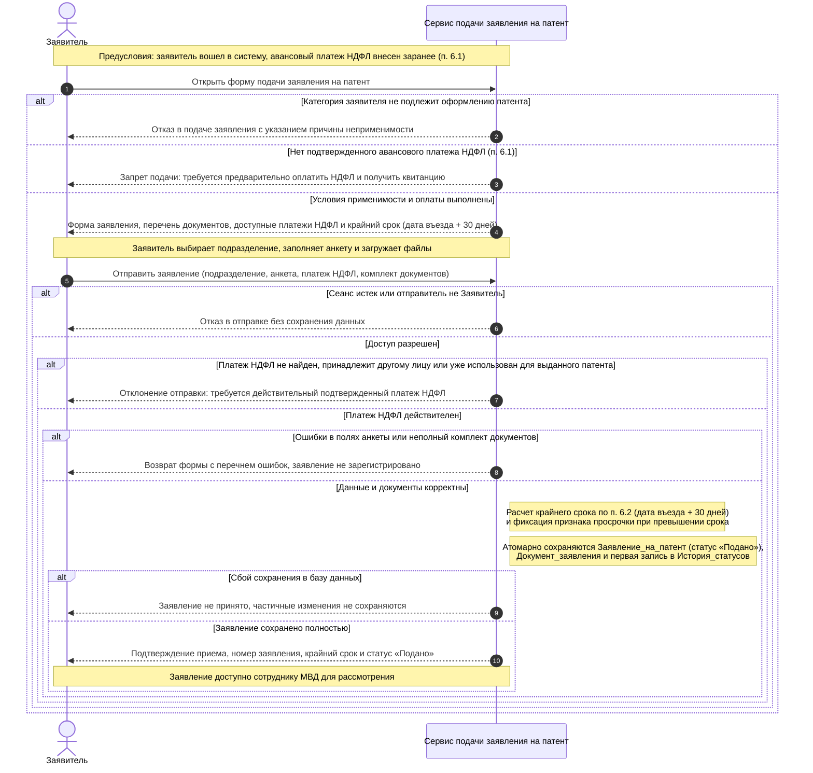

````markdown
# Лабораторная работа № 3. Системная диаграмма последовательностей

**Тема №6:** Подача заявления и получение патента.



## Выбранный прецедент и границы

Выбран один прецедент из [lab01](use_case.md): **«Подача заявления и комплекта документов на выдачу патента» (`UC_Apply`)**, включая шаг **«Прикрепление комплекта документов и чека об уплате НДФЛ» (`UC_AttachDocs`)**. Цель заявителя - подать заполненное заявление с пакетом документов в подразделение МВД или ФГУП «ПВС» МВД России по месту пребывания. Предварительная оплата НДФЛ (`UC_PayNDFL`), проверка заявки инспектором (`UC_Review`), доработка по запросу (`UC_FixApp`) и выдача патента (`UC_GetPatent`) относятся к другим прецедентам и в этом сценарии не выполняются.

Диаграмма показывает взаимодействие внешнего участника с системой как единым целым. `Заявитель` - иностранный гражданин; `Сервис подачи заявления на патент` - граница приложения. Сплошные стрелки обозначают запросы заявителя, пунктирные - ответы системы, блоки `alt/else` - взаимоисключающие исходы. Примечания справа от линии системы описывают внутренние вычисления и гарантии сохранения без детализации до классов.

Сотрудник МВД начинает проверку после регистрации заявления, а банковская квитанция НДФЛ сохранена в базе на этапе `UC_PayNDFL`, поэтому отдельные линии для сотрудника, платежного шлюза и SMS-шлюза здесь не требуются.

## Предусловия и входные данные

- Заявитель зарегистрирован и вошел в систему по номеру телефона и SMS-коду (`UC_Auth`, в учебной версии код `123456`).
- В профиле `Пользователь` заполнены ФИО, дата рождения, паспортные данные, гражданство, дата въезда в РФ, адрес пребывания и признаки льготных категорий (`признак_вкс`, `член_семьи_вкс`, `участник_переселения`, `член_семьи_переселенца`).
- До подачи заявления в системе зафиксирован минимум один подтвержденный `Авансовый_платеж_НДФЛ` за первый месяц действия патента (пункт 6.1 дорожной карты).

При открытии формы система проверяет профиль и возвращает доступные для привязки платежи и расчетный крайний срок. При отправке заявитель передает тип и адрес подразделения обращения (МВД или ПВС МВД), данные анкеты, идентификатор платежа НДФЛ и файлы комплекта документов (включая квитанцию об оплате). Идентичность пользователя определяется из активного сеанса, а не из параметров запроса.

## Основной сценарий

1. Заявитель открывает форму подачи заявления на патент. Система проверяет соответствие профиля условиям раздела 6 и наличие подтвержденного платежа НДФЛ.
2. При выполнении предусловий система рассчитывает крайний срок подачи по п. 6.2 (30 календарных дней со дня въезда в РФ) и отдает форму заявления со списком обязательных документов.
3. Заявитель выбирает подразделение МВД или ПВС МВД по месту пребывания, заполняет анкету, прикрепляет комплект документов и скан квитанции НДФЛ (`UC_AttachDocs`), после чего отправляет заявку.
4. Система повторно проверяет сеанс, принадлежность и статус выбранного платежа НДФЛ, затем валидирует обязательные поля анкеты и состав загруженных файлов.
5. Система фиксирует признак соблюдения или нарушения 30-дневного срока и атомарно сохраняет новое заявление в статусе «Подано», связанные документы и первую запись в истории статусов.
6. Заявитель получает подтверждение приема с номером заявления, крайним сроком подачи и текущим статусом.

## Условия применимости и альтернативы

Правила ниже соответствуют разделу 6 дорожной карты и согласованы с [ER-моделью lab02](er.md).

| Условие | Поведение системы |
| --- | --- |
| Гражданство Азербайджана, Таджикистана, Узбекистана, Молдовы или Украины; все четыре признака ВКС и программы переселения равны `false` | Подача заявления доступна; система открывает форму и рассчитывает крайний срок. |
| Иное гражданство либо установлен статус ВКС, члена семьи ВКС, участника программы переселения или члена его семьи | Отказ в подаче заявления с объяснением, что для данной категории оформление патента не применяется (п. 6.1). |
| Нет подтвержденного авансового платежа НДФЛ | Подача блокируется до выполнения `UC_PayNDFL` и получения банковского документа об оплате. |
| Выбранный платеж НДФЛ чужой или уже связан с заявлением, по которому выдан патент | Отправка отклоняется; допускается повторная привязка только того платежа, по которому ранее был отказ без выдачи патента. |
| Сеанс истек во время заполнения формы | Отправка отклоняется без сохранения данных; требуется повторный вход по телефону и SMS-коду. |
| Не заполнены обязательные поля или не хватает документов | Форма возвращается с перечнем ошибок; заявление и запись в истории не создаются. |
| Дата подачи превышает `дата_въезда_в_рф + 30 дней` (п. 6.2) | Заявление принимается с фиксацией просрочки в заявке и комментарии истории статусов для учета при рассмотрении инспектором МВД. |
| Сбой сохранения в базу данных | Прием не завершается; частичное сохранение заявки без документов или истории не допускается. |

## Результат и согласованность данных

При успешном завершении сценария в базе создается одна запись `Заявление_на_патент` со статусом «Подано» и ссылкой `id_платежа_ндфл` на использованный `Авансовый_платеж_НДФЛ`, набор записей `Документ_заявления` (с `id_запроса_доработки = NULL` для первичного комплекта) и начальная запись `История_статусов` с переходом в «Подано», где инициатором указан сам заявитель.

При любой ошибке проверки или сбое сохранения новые записи не создаются, а статус платежа НДФЛ остается прежним, чтобы заявитель мог исправить ошибки и повторить отправку без потери данных об оплате.
````
